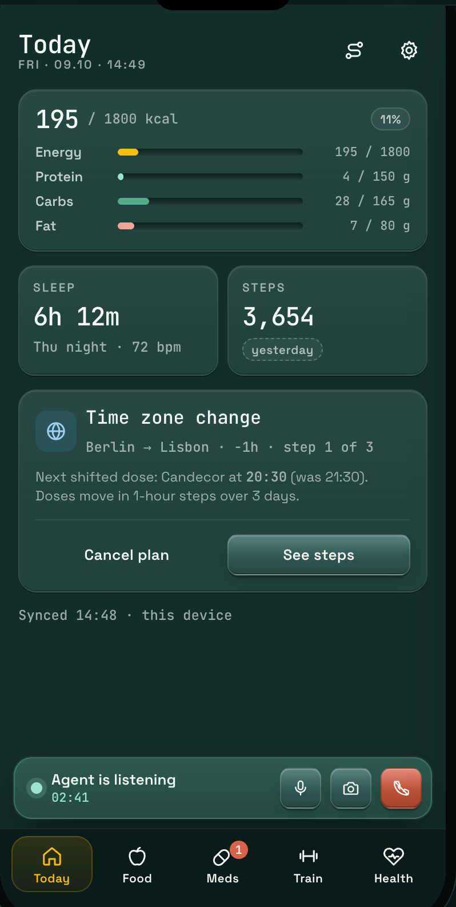
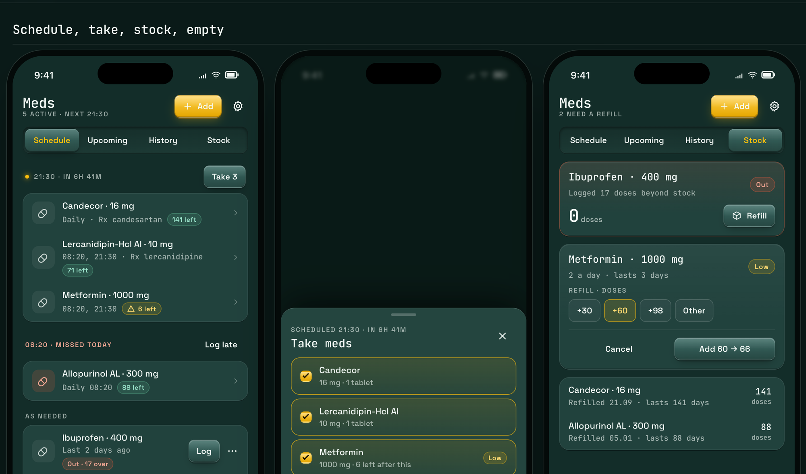
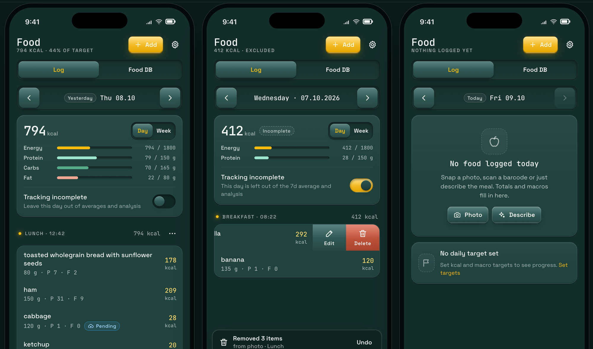
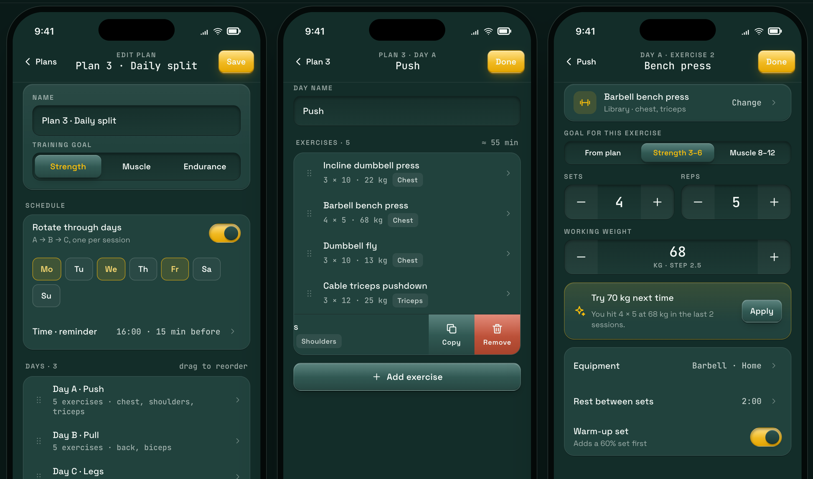

# Med Tracker

**A self-hosted, end-to-end encrypted health tracker: medications, blood pressure, weight, workouts, food, sleep, and notes in one installable PWA.**

Privacy-first apps often cost you convenience: no sync across devices, reminders that don't fire, no assistant. This one tries not to. The vault is end-to-end encrypted and the keys stay on your devices, and you still get real-time sync, reminders that ring on schedule, offline logging, an optional Telegram chat, and your own AI (including Claude over MCP) pointed at your own data.

The server running it can't read the vault. The optional integrations you switch on (Telegram, trial AI, voice, the hosted Claude connector, food lookup) deliberately leave it, and each one is listed in [the privacy boundary table](docs/cloud-mode.md#privacy-boundary--the-vault-promise-and-its-carve-outs).

  

---

## What you get

**Today** — one screen for the day: calories and macros against your targets, last night's sleep, steps, and anything that needs you, like a time-zone change that shifts your doses in 1-hour steps over a few days. Each card links into its section.

**Medications** — scheduled, weekly, and as-needed doses · take several at once or log a missed one late · intake history · stock tracking with low/out badges, days-left estimates, and quick refills · drug-interaction checks · CSV export.

**Food** — log by photo, barcode, or a plain description ("chicken breast with rice") that AI splits into items · Open Food Facts search and your own food DB · saved meals · daily and weekly progress against kcal and macro targets · mark a day as incomplete so it stays out of averages · undo for bulk removals.

**Workouts** — training plans with rotating day splits (A/B/C like push/pull/legs) · per-exercise sets, reps, weight, rest, and warm-up · per-set logging, history, 1RM and PR analysis · opt-in progression hints ("Try 70 kg next time") · reminders before a session · Mi Band and external feed import.

**Vitals** — blood pressure (goals, reminders, statistics, imports) · weight (goals, EMA trend, Libra-compatible export) · sleep, heart rate, SpO2, stress, and daily steps in one overview.

**Diary** — free-text notes, included as context when you ask your AI for an analysis.

**Everywhere** — web push · offline-first with pending-sync markers · installs to the home screen on iOS and Android · automatic time-zone detection with confirmation · a voice agent you can talk to while logging.

## How the privacy works: your devices hold the keys, the server holds a sealed blob

There are two kinds of place your data can live, and this app is careful about which is which.

- **Your devices** hold the keys and the plaintext. Encryption and decryption happen in your browser. A passkey (Face ID, fingerprint) unwraps a random data key that never leaves the device.
- **The server** holds only a sealed, encrypted blob of your vault. It's a *blind* sync-and-backup hub: it stores ciphertext, relays it between your devices, and rings your reminders on schedule, without ever holding the key to open any of it. Against the vault, a full breach, a subpoena, or a curious operator yields ciphertext and timing metadata, not your health. That guarantee covers the vault; it does not cover the opt-in integrations below, which are a separate, enumerated trust decision.

This is what makes the convenience possible. Because your own devices can decrypt, you don't lose anything to the encryption:

- **Sync just works.** An encrypted oplog replicates every change across your devices. Add a reading on your phone, it's on your laptop.
- **It works offline.** Log a BP reading on the subway; it syncs when you're back.
- **Nothing is trapped.** Export the whole vault whenever you want and take it home.

## Reminders and Telegram still work

The hard part of "the server can't read your data" is usually the stuff that *needs* to reach you: notifications and chat. Both survive the encryption boundary intact.

- **Reminders via a blind push relay.** The server delivers your medication and workout reminders on schedule, but the reminder *content* is encrypted client-side before it's ever uploaded. The relay knows *when* to ring the alarm, not *what it's for*. It rings; your device decrypts and shows the real text.
- **Install it like an app.** The PWA installs to your home screen on iOS and Android, works offline, and receives web push. No app store, no separate build.
- **Optional Telegram chat.** Bring your own bot token and answer a reminder, log a reading, or ask what's due next in the chat you already have open. Inbound messages land in a sealed mailbox. It's off by default. Unlike the vault, Telegram text crosses the relay in plaintext by design, so it's a clearly labeled opt-in, not the default path.

> **The promise, in full.** Your vault is end-to-end encrypted: every health record you store and sync. The keys never leave your devices, and the server holds only ciphertext it cannot open. Optional integrations you turn on reach outside that vault and have separately disclosed boundaries.
>
> Those integrations, in full, split by how each one switches on:
>
> - **Off until you turn them on:** **Telegram** (message text crosses the relay in the clear both ways; the bot token is sealed under a server-held key, not your vault key), **trial AI** and **trial voice** on the operator's OpenAI/ElevenLabs accounts, and the **hosted Claude connector** (tier 2: the operator runs the shim and sees query and response content). The local Claude shim is *not* in this list: it stays sealed end-to-end.
> - **Active whenever you use the feature, with no separate switch:** the **operator-default food database** (search terms and barcodes cross an operator proxy; setting your own endpoint in Settings removes the operator from that path) and **drug lookups** to RxNav (always proxied; there is no bring-your-own alternative).
>
> Each is spelled out in Settings → Account & privacy → *What the operator can see* and in the [privacy boundary table](docs/cloud-mode.md#privacy-boundary--the-vault-promise-and-its-carve-outs).

## How it is put together

A self-hosted **encrypted cloud** serves one installable PWA per user, on their own subdomain. All health logic runs in the browser; every vault record is end-to-end encrypted.

- **Passkey-only unlock** — WebAuthn PRF unwraps a random 256-bit data key. No passwords, no server-side secret to crack.
- **On the vault path, the server sees only ciphertext + timing metadata** — health data, provider keys, and reminder content are all encrypted. Opt-in integrations are the documented exception.
- **Encrypted sync + blind push relay** — an encrypted oplog syncs your devices; a blind relay delivers reminders it can't read.
- **Emergency Kit** — a high-entropy recovery code re-enrolls a new device if you lose all your others.
- **Bring your own keys** — AI, vision, voice, and food-DB keys live inside your vault and are called from your browser.
- **Optional Telegram** — bring your own bot token; inbound messages land in a sealed mailbox. Off by default.

Registration is invite-only. See [docs/architecture.md](./docs/architecture.md) for the shape of the system and [docs/cloud-crypto.md](./docs/cloud-crypto.md) for the key management.

## Your AI, your data

Want your assistant to analyze your blood pressure against your sleep and medications? A fitness summary blending workouts, steps, nutrition, weight, and your own notes?

Your AI runs **in your browser**, against your own provider keys stored inside the encrypted vault, so the operator never sees the prompt or the data. If you'd rather not bring a key, a shared trial key is available as an opt-in with its own consent step; on that path your prompt and any meal photo travel through the operator's server to the operator's OpenAI account, so it is explicitly *not* end-to-end encrypted.

Point **Claude (or any MCP client)** at your vault and it can read and write through the same operation catalog the app itself uses, including composite analyses like `analyze_cardiovascular` (BP + meds + sleep + HR + SpO2 + notes) and `analyze_fitness` (workouts + steps + nutrition + weight + notes). Two ways to connect, and the difference is a trust decision you make explicitly:

- **Local shim** — a small binary on your own machine talks to an unlocked tab over a *blind* relay. The frames are opaque; the operator sees sizes and timing, never content.
- **Hosted connector** — for claude.ai / ChatGPT, which cannot run a local shim. The operator runs it for you and therefore sees queries and answers in transit. Off by default, per-account, and clearly labeled as the downgrade it is.

Either way an unlocked tab of yours is what actually answers; there is no server-side fallback, because the server has nothing to read. Your diary notes ride along as context, so the AI understands *why* a week looked the way it did.

## Get it running

**[Deployment guide](./docs/cloud-deployment.md)** — stand up the service (Traefik + a wildcard cert + `cmd/cloud`), then mint an invite. Users open a URL and create a passkey. Works from a published container image or your own build.

## Security posture

An end-to-end-encrypted vault, passkey-only unlock (WebAuthn PRF over a random 256-bit key), a blind push relay, encrypted oplog sync, Emergency Kit recovery, and invite-only registration. The optional integrations that leave that boundary are enumerated, with code evidence, in the [privacy boundary table](docs/cloud-mode.md#privacy-boundary--the-vault-promise-and-its-carve-outs).

**The honest version, if you are deciding whether to trust it:**
[docs/security/threat-model.md](./docs/security/threat-model.md) sets out the
assets, the trust boundaries, what holds, what leaks by design, and the ranked
residual risks, starting with the big one: the operator serves the
JavaScript that handles your key
([docs/security/release-integrity.md](./docs/security/release-integrity.md)).
Key formats and ceremonies: [docs/cloud-crypto.md](./docs/cloud-crypto.md).

---

## For contributors and operators

- **Contributors**: start with [docs/README.md](./docs/README.md), the documentation map: which docs are normative, which are proposals, and which are history. [CLAUDE.md](./CLAUDE.md) carries the repo's working rules.
- **License**: see [LICENSE](./LICENSE).
